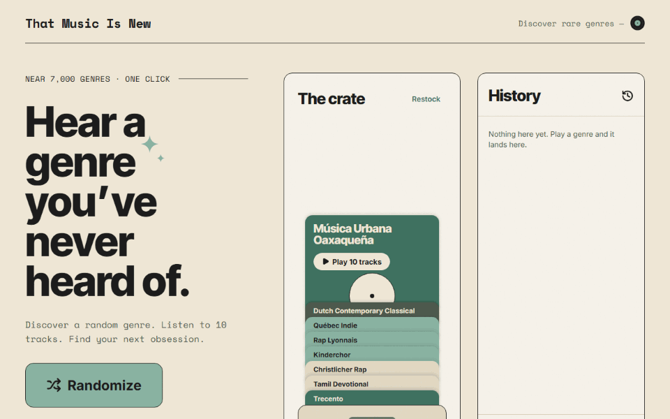
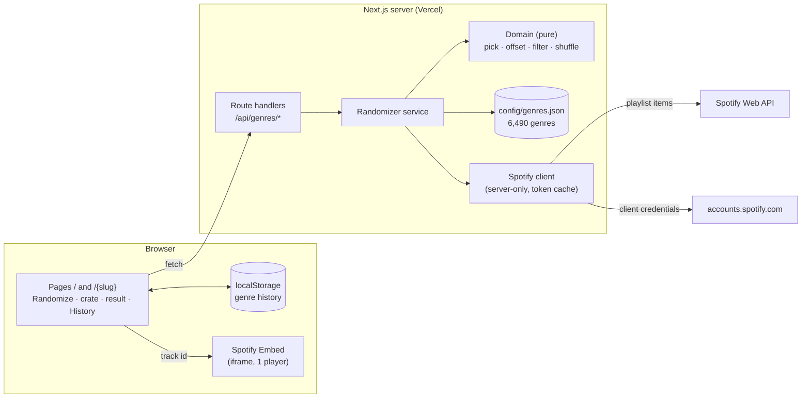

# That Music Is New

A door into rare music genres. One click → a random genre from 6,490 real Spotify genres and 10 of its tracks to listen to, right in the page. If a genre clicks, keep exploring it on Spotify.

**[▶ Try it live](https://that-music-is-new-seven.vercel.app/)**



> Status: **v1.0.0**: iteration 1 (Randomizer) is complete and live. What changed in each version: [CHANGELOG](CHANGELOG.md).

## Links

[](https://design.penpot.app/?screen=viewer&file-id=110d30a4-9d92-80de-8008-ee26a65adfd7&page-id=110d30a4-9d92-80de-8008-ee26a65adfd8&section=interactions&index=0&share-id=2ffa9ce6-5d22-4f57-a813-66d4d19c4d19)

[](https://design.penpot.app/?screen=viewer&file-id=110d30a4-9d92-80de-8008-ee26a65adfd7&page-id=3c1543f6-2e31-80fc-8008-f1289998b7e0&section=interactions&index=0&share-id=7f9dba8d-d809-4d98-b1a8-dbf920b0d5ed)

[](https://design.penpot.app/?screen=viewer&file-id=110d30a4-9d92-80de-8008-ee26a65adfd7&page-id=c2a93463-2d22-807c-8008-f3373ae1170b&section=interactions&index=0&share-id=7f9dba8d-d809-4d98-b1a8-dbf920b0d5ed)

[](https://that-music-is-new-seven.vercel.app/)

[](https://github.com/IvanSaNRoD/that-music-is-new/actions/workflows/ci.yml)

[](https://github.com/IvanSaNRoD/that-music-is-new/releases/latest)

## Features (iteration 1)

- **Randomizer**: a crate of 8 random genres (Restock for more) and a Randomize button (or Space) → a genre page with up to 10 of its tracks. No login.
- **Genre page**: its own URL (`/{genre}`) to share, the track count, a link to its "The Sound of X" playlist on Spotify, and Roll again for another genre.
- **Playback** in the page through one Spotify Embed player. Track 01 starts on its own when you came to listen, ⏮ / ⏭ walk the list, and the turntable spins only while Spotify plays.
- **History** of the genres you played, kept in `localStorage`: reopen one, delete one with undo, or clear all.
- **Accessible and responsive**: WCAG 2.2 AA (axe, keyboard, reduced motion), 320–1920px, touch layout on phones.

Full scope: [PRD](docs/prd.md).

## How it works



1. **Randomize** asks our API for a random genre. It is picked from a catalog built offline, so this step never calls Spotify.
2. The **genre page** asks for that genre's tracks. The server makes one Spotify call, from a random offset in the genre's "The Sound of X" playlist, keeps the tracks playable in your country and shuffles them.
3. The browser plays a track in the **Spotify Embed** and saves the genre to **History** in `localStorage`. Spotify credentials and tokens never reach the browser.

Step by step, with the files involved: [How a request flows through the app](docs/guides/request-flow.md). Details: [Architecture](docs/architecture.md).

## Key decisions

| Decision | Why | Record |
|---|---|---|
| Play tracks with the official Spotify Embed | Works for every listener: full tracks when logged in to Spotify in the browser, 30 s previews otherwise (the Web Playback SDK needs Premium) | [ADR-0001](docs/adr/0001-playback-spotify-embed.md) |
| No user login; the server uses Client Credentials | Anyone can use it in one click; secrets stay on the server | [ADR-0002](docs/adr/0002-auth-spotify-oauth-pkce.md) |
| Genres from Spotify's "The Sound of X" playlists, catalog built offline | Spotify's `genre:` search returned too few or wrong tracks (spike); one API call per genre page | [ADR-0003](docs/adr/0003-randomizer-search-strategy.md) |
| Next.js + TypeScript + Tailwind + shadcn/ui, Vitest + Playwright | One deployable app with a server for the secrets; well-known, tested stack | [ADR-0004](docs/adr/0004-tech-stack.md) |
| UI organised by feature, pure domain layer, lint-enforced boundaries | Each feature is easy to find; logic tested without React or I/O | [ADR-0005](docs/adr/0005-frontend-feature-folders.md) |
| Every genre is a page (`/{slug}`) | Shareable, reloadable, Back works, SEO | [ADR-0006](docs/adr/0006-routing-genre-pages.md) |
| The API takes a genre slug, never free text | No open proxy to Spotify; picking a genre costs no Spotify call | [ADR-0007](docs/adr/0007-api-by-slug.md) |
| Static CSP without nonces | Keeps pages prerendered and the Spotify Embed working; trade-offs recorded | [ADR-0008](docs/adr/0008-csp-without-nonces.md) |
| Design in code, Penpot for documentation (2026-11-12) | Screens built blind through Penpot's API lacked polish; in code the see-fix loop is immediate | [Design workflow](#design-workflow) |

## Tech stack

| Area | Choice |
|---|---|
| Framework | Next.js (App Router) + TypeScript (strict) |
| Styling | Tailwind CSS + shadcn/ui |
| Validation | zod |
| Spotify | `fetch` in a server-only module (Client Credentials) + Spotify Embed |
| Tests | Vitest + Testing Library, MSW, Playwright |
| Quality | ESLint, Prettier, Husky + lint-staged, commitlint |
| CI / Hosting | GitHub Actions / Vercel |
| Design | Designed in code with the [impeccable](https://github.com/pbakaus/impeccable) skill · exploration in Claude Design · Penpot for documentation |

Why each choice: [ADR-0004](docs/adr/0004-tech-stack.md).

## Design system

**Source of truth: [`DESIGN.md`](DESIGN.md)** (North Star "The Record Crate": tokens, named rules, components; machine-readable sidecar in `.impeccable/design.json`) and the code itself. Screen briefs live in [`docs/design/`](docs/design/). Penpot mirrors the finished design as documentation: [public link](https://design.penpot.app/?screen=viewer&file-id=110d30a4-9d92-80de-8008-ee26a65adfd7&page-id=110d30a4-9d92-80de-8008-ee26a65adfd8&section=interactions&index=0&share-id=2ffa9ce6-5d22-4f57-a813-66d4d19c4d19).

- **Palette**: Seiji–Kinari (traditional Japanese colors): Kinari `#F3EBDA` paper, Seiji `#8DB6A5` single accent, Sumi `#1C1C1C` ink and outlines. Five sleeve tones give each genre its own color (Genre Tone Rule). All text pairs pass WCAG AA.
- **Type**: Inter Tight (display) + Inter (UI) + Space Mono (catalog data: counts, dates, shortcuts).
- **Tokens**: CSS variables in [`src/app/globals.css`](src/app/globals.css), named like shadcn/ui (`background`, `primary`, `muted-foreground`…).
- **Status**: home and genre page (turntable) are final in code for desktop and for mobile + touch (one layout below 1024px; tablets use it in a centred column). Penpot documents both: *Desktop (final)* and *Mobile (final)* pages, captured from the coded design.

## Design workflow

Changed on 2026-11-12: screens built in Penpot through its plugin API were assembled "blind" and lacked polish, so design moved into code, where the see-fix loop is immediate.

1. **Explore in Claude Design.** Visual options for a screen are generated in Claude Design and exported as a handoff (HTML/React reference) into [`docs/claude-design/`](docs/claude-design/) (Crate Flip for the home, Turntable for the genre page). Handoffs are references, not code: they are re-implemented with the project's tokens and rules.
2. **Build in code with impeccable.** The [impeccable](https://github.com/pbakaus/impeccable) skill drives every step: `shape` (brief in `docs/design/`) → implement → `live` (variants in the browser) → `audit` (technical: a11y, performance, responsive) → `critique` (UX heuristics, personas) → `layout` / `harden` / `polish` (fixes) → `document` (updates `DESIGN.md`). Its detector also runs on every UI edit through a hook.
3. **Critique with isolated subagents.** `critique` runs two subagents in parallel that never see each other's output: one does the design review (heuristics, cognitive load, personas) and the other gathers deterministic evidence (detector scans, headless-browser measurements such as contrast, focus order and layout stability). Keeping them apart stops the detector's findings from anchoring the design judgment. Each re-run uses fresh subagents without access to earlier reports.
4. **Document in Penpot.** Once a screen is final, its tokens and screenshots are copied to Penpot so the design stays documented outside the code.

## AI-assisted workflow

Built with Claude Code. Decision: **one main agent, no subagents by default.**

Why:
- **Small, sequential project**: one-page app, 36 issues that mostly depend on each other (scaffold → domain → API → UI → tests). Little truly parallel work.
- **Cost and context**: each subagent starts cold — it doesn't know prior decisions (ADRs, palette, conventions), re-reads files and risks inconsistencies.
- **Learning**: a linear flow (issue → code → tests → commit → README) is easier to follow and review than parallel agents and branch merges.
- **Penpot MCP**: the connection depends on one active browser tab; several agents on it would be fragile.

Where subagents/extra reviews *are* used:

| Case | When | Why |
|---|---|---|
| `/code-review` | Before closing logic-heavy issues (E3, E4) | Independent review of code the main agent wrote |
| `/security-review` | F1 (hardening) | Specialized security pass |
| `/impeccable critique` | Every design review | Two isolated subagents (design review ∥ detector/browser evidence) so findings don't anchor each other |
| Isolated review subagent | Before the E2 PR | Fresh eyes on the diff: found 2 tests passing for the wrong reason (order-dependent 401 retry, untested episode branch) |
| Parallel domain subagent | E3 (training exercise, 2026-11-16) | Pure domain functions (#17) own their files, so one subagent wrote them test-first while the main agent built catalog, service and routes; the contract (types + signatures) was fixed first |
| Research subagents (read-only) | E4 planning (2026-11-16) | Two in parallel answered the open risks before coding: how the Spotify iFrame API really works (152px, `loadEntity`, autoplay) and how to keep e2e off real Spotify (3 layers; Next's experimental testmode rejected) |
| Parallel build subagents | E4 (2026-11-16) | One built the embed wrapper (TDD), one the e2e infrastructure (fake Spotify server, fixtures); the main agent wired data and UI. Contracts (types, env names, hook API) fixed first |
| Parallel work (optional) | E2 Spotify client ∥ E4 UI with mock data | Independent; only if pace needs it |

### Skills

| Skill | Used for | Why this one |
|---|---|---|
| [impeccable](https://github.com/pbakaus/impeccable) | All design work (see Design workflow) | Covers shape → live → audit → critique → document in one tool |
| [tdd](https://skills.sh/mattpocock/skills/tdd) (`mattpocock/skills`) | Domain and server logic from E3 on | Most installed TDD skill (1.2M installs, repo ★325K, MIT, docs only). Red → green in vertical slices, tests only at seams agreed with the human, no tautological or implementation-coupled tests |
| `/code-review` (built-in) | Before closing logic-heavy issues | Structured bug review of the diff |

Choosing a skill: search (`npx skills find <topic>`), then check installs, repo stars, license and author, and **read the SKILL.md before installing** — skills run with the agent's permissions.

## Getting started

```bash
npm install
cp .env.example .env.local   # then fill in your Spotify app credentials
npm run dev     # http://localhost:3000
npm run build   # production build
npm run lint          # ESLint, incl. architecture boundaries (ADR-0005)
npm run typecheck     # tsc --noEmit
npm run format        # Prettier (+ Tailwind class order); format:check in CI
npm test              # Vitest + Testing Library (unit/component, Spotify mocked with MSW)
npm run test:e2e      # Playwright, desktop + touch phone (first time: npx playwright install chromium)
```

Git hooks (Husky, installed by `npm install`): `pre-commit` runs ESLint + Prettier on staged files (lint-staged); `commit-msg` enforces conventional commits (commitlint).

Design tokens live in [`src/app/globals.css`](src/app/globals.css); the rules that use them are in [`DESIGN.md`](DESIGN.md).

## Docs

- [PRD](docs/prd.md) · [Architecture](docs/architecture.md) · [Backlog](docs/backlog.md) · [Changelog](CHANGELOG.md)
- [Retrospective](docs/retrospective.md): estimated vs real hours and lessons
- [How a request flows through the app](docs/guides/request-flow.md) — step-by-step guide for humans
- ADRs: [0001 Playback](docs/adr/0001-playback-spotify-embed.md) · [0002 Auth](docs/adr/0002-auth-spotify-oauth-pkce.md) · [0003 Randomizer strategy](docs/adr/0003-randomizer-search-strategy.md) · [0004 Tech stack](docs/adr/0004-tech-stack.md) · [0005 Feature folders](docs/adr/0005-frontend-feature-folders.md) · [0006 Routing](docs/adr/0006-routing-genre-pages.md) · [0007 API by slug](docs/adr/0007-api-by-slug.md) · [0008 CSP](docs/adr/0008-csp-without-nonces.md)
- Task board: [GitHub Projects](https://github.com/users/IvanSaNRoD/projects/1)

## Progress

| Date | Issue | Done |
|---|---|---|
| 2026-11-09 | — | Definition: PRD, architecture, ADR-0001…0004, Spotify API spike |
| 2026-11-10 | — | Planning: backlog → 36 issues on GitHub Projects |
| 2026-11-11 | [#1](https://github.com/IvanSaNRoD/that-music-is-new/issues/1) | Penpot connected to Claude Code via MCP |
| 2026-11-11 | [#2](https://github.com/IvanSaNRoD/that-music-is-new/issues/2) | Design tokens in Penpot (Seiji–Kinari palette, type, spacing, radius) |
| 2026-11-11 | [#3](https://github.com/IvanSaNRoD/that-music-is-new/issues/3) | Screens in Penpot: home, loading, result, error, clear-history dialog — desktop + mobile |
| 2026-11-11 | [v0.1.0](https://github.com/IvanSaNRoD/that-music-is-new/releases/tag/v0.1.0) | Milestone: definition, planning and design done (phases A–C) |
| 2026-11-12 | [#4](https://github.com/IvanSaNRoD/that-music-is-new/issues/4) | Scaffold: Next.js 16 (App Router, TS strict), Tailwind v4, shadcn/ui (Radix); Penpot tokens → CSS variables; architecture folders |
| 2026-11-15 | [#42](https://github.com/IvanSaNRoD/that-music-is-new/issues/42) | Mobile + touch design: one layout below 1024px, mini turntable + bottom bar on the genre page, touch targets ≥44px; documented in Penpot |
| 2026-11-15 | [#5](https://github.com/IvanSaNRoD/that-music-is-new/issues/5) | Quality: Prettier (+ Tailwind class order), ESLint architecture boundaries (ADR-0005), Husky + lint-staged, commitlint |
| 2026-11-15 | [#6](https://github.com/IvanSaNRoD/that-music-is-new/issues/6) | Tests: Vitest + Testing Library (unit/component), MSW (Spotify mocks), Playwright e2e on desktop + touch phone |
| 2026-11-15 | [#7](https://github.com/IvanSaNRoD/that-music-is-new/issues/7) | Claude config: PR template, project gotchas in CLAUDE.md (one main agent, no subagents by default) |
| 2026-11-15 | [#8](https://github.com/IvanSaNRoD/that-music-is-new/issues/8) | CI: GitHub Actions (format · lint · typecheck · unit · build · e2e), protected `main` |
| 2026-11-15 | [#9](https://github.com/IvanSaNRoD/that-music-is-new/issues/9) | Deploy: Vercel (production + preview per PR), `.env.example`, Node 24 engine |
| 2026-11-15 | [#10](https://github.com/IvanSaNRoD/that-music-is-new/issues/10) | Milestone: walking skeleton — deployed on Vercel, CI green on `main` (phase D done) |
| 2026-11-15 | [v0.2.0](https://github.com/IvanSaNRoD/that-music-is-new/releases/tag/v0.2.0) | Milestone: technical foundations + final design (desktop, mobile, touch) |
| 2026-11-15 | [#11](https://github.com/IvanSaNRoD/that-music-is-new/issues/11) | Genre catalog script: paginates `thesoundsofspotify` at 1 req/s, honours `429`, keeps "The Sound of …" genres |
| 2026-11-15 | [#12](https://github.com/IvanSaNRoD/that-music-is-new/issues/12) | `config/genres.json` generated and committed: 6,490 genres `{ genre, playlistId, total }` |
| 2026-11-16 | [#13](https://github.com/IvanSaNRoD/that-music-is-new/issues/13) | Spotify token: Client Credentials, cached per instance, refreshed before expiry, shared in-flight request |
| 2026-11-16 | [#14](https://github.com/IvanSaNRoD/that-music-is-new/issues/14) | `getPlaylistItems` with zod schemas; visitor's market (`is_playable`); malformed entries → `null`; 401 → one retry |
| 2026-11-16 | [#15](https://github.com/IvanSaNRoD/that-music-is-new/issues/15) | Error mapping: Spotify `429` → `503` + `Retry-After`, other → `502` |
| 2026-11-16 | [#16](https://github.com/IvanSaNRoD/that-music-is-new/issues/16) | MSW Spotify mocks: playlist items fixtures (playable, unplayable, local, removed, episodes) + 429/5xx/401 overrides |
| 2026-11-16 | [#17](https://github.com/IvanSaNRoD/that-music-is-new/issues/17) | Domain (TDD, parallel subagent): `pickGenre`, `randomOffset`, `filterPlayable`, `shuffle`, `toMarket` |
| 2026-11-16 | [#18](https://github.com/IvanSaNRoD/that-music-is-new/issues/18) | Catalog: `genres.json` validated once, indexed by slug, slug-collision guard |
| 2026-11-16 | [#19](https://github.com/IvanSaNRoD/that-music-is-new/issues/19) | Randomizer service: pick (no Spotify) + genre sample (one Spotify call, live total) |
| 2026-11-16 | [#20](https://github.com/IvanSaNRoD/that-music-is-new/issues/20) | API by slug (ADR-0007): `/api/genres/random?exclude=`, `/api/genres/{slug}` — `no-store`, visitor market, 404/503/502/500 |
| 2026-11-16 | [#21](https://github.com/IvanSaNRoD/that-music-is-new/issues/21) | Randomize + crate on real data: `/api/genres/crate` (8 random genres), Restock, loading/error states |
| 2026-11-16 | [#22](https://github.com/IvanSaNRoD/that-music-is-new/issues/22) | Genre page on the real catalog (on demand): tracks, live track count, playlist link |
| 2026-11-16 | [#23](https://github.com/IvanSaNRoD/that-music-is-new/issues/23) | Spotify Embed player: one 152px embed, track 01 cued, `loadEntity` + `play` in the click, "Dig deeper" fallback |
| 2026-11-16 | [#24](https://github.com/IvanSaNRoD/that-music-is-new/issues/24) | Loading / empty / error / busy (Retry-After) states with retry; e2e in 3 layers against a fake Spotify |
| 2026-11-16 | [v0.3.0](https://github.com/IvanSaNRoD/that-music-is-new/releases/tag/v0.3.0) | Milestone: real genres, real music — catalog, Spotify client, API and UI on real data (E1–E4) |
| 2026-11-16 | [#25](https://github.com/IvanSaNRoD/that-music-is-new/issues/25) | History kept between visits: `localStorage` store (`useSyncExternalStore`), zod-validated on read, works without storage, syncs across tabs |
| 2026-11-16 | [#26](https://github.com/IvanSaNRoD/that-music-is-new/issues/26) | History panel: recent first, delete one with undo, clear all with confirmation — e2e: reload, delete, undo, clear |
| 2026-11-16 | [#27](https://github.com/IvanSaNRoD/that-music-is-new/issues/27) | History row → `/{slug}` → genre page with a fresh sample (e2e) |
| 2026-11-16 | [#54](https://github.com/IvanSaNRoD/that-music-is-new/issues/54) | Your finds: remove a find on the genre page (✕ on pills and sleeves) with undo, keyboard focus → Undo |
| 2026-11-16 | [v0.4.0](https://github.com/IvanSaNRoD/that-music-is-new/releases/tag/v0.4.0) | Milestone: your finds, kept — persistent History, remove finds on genre pages (E5) |
| 2026-11-16 | [#31](https://github.com/IvanSaNRoD/that-music-is-new/issues/31) | SEO: titles + canonical per page, share images (site + per genre), vinyl favicon, own 404/500 pages, robots + sitemap of every genre |
| 2026-11-16 | [#62](https://github.com/IvanSaNRoD/that-music-is-new/issues/62) | Research: autoplay track 01 — real-embed experiment + browser policies; rule in the PRD (autoplay only with listening intent), implementation #67 |
| 2026-11-16 | [#58](https://github.com/IvanSaNRoD/that-music-is-new/issues/58) | Crate: long genre names no longer push the Play pill into the die-cut hole (fixed 44px name block, width-fitted short names, one-line tabs) |
| 2026-11-16 | [#61](https://github.com/IvanSaNRoD/that-music-is-new/issues/61) | Turntable follows the Spotify Embed's real playback: spins only while Spotify confirms it plays (pause, end or blocked audio → still) |
| 2026-11-17 | [#55](https://github.com/IvanSaNRoD/that-music-is-new/issues/55) | Player: ⏮ / ⏭ on the turntable plinth (phone: bottom bar row), auto-advance with no loop; full-width Roll again on phones |
| 2026-11-17 | [#67](https://github.com/IvanSaNRoD/that-music-is-new/issues/67) | Player: track 01 autoplays when a genre is opened to listen (Randomize, Space, Roll again, sleeve Play); a quiet hint when the browser blocks it |
| 2026-11-17 | [#53](https://github.com/IvanSaNRoD/that-music-is-new/issues/53) | Randomize: a failed roll says so next to the CTA ("Couldn’t reach the crate — try again"), announced once, cleared by the next good roll or a page change |
| 2026-11-17 | [v0.5.0](https://github.com/IvanSaNRoD/that-music-is-new/releases/tag/v0.5.0) | Milestone: the record player grows up — autoplay with listening intent, ⏮ / ⏭, turntable follows real playback, share-ready pages, failed-roll feedback |
| 2026-11-18 | [#57](https://github.com/IvanSaNRoD/that-music-is-new/issues/57) | Crate loading feels alive: "Digging through the bins…" on the open sleeve, sleeves riffle while loading, Restock keeps the old ones dimmed, fresh genres drop in one by one (reduced motion: opacity only) |
| 2026-11-18 | [#65](https://github.com/IvanSaNRoD/that-music-is-new/issues/65) | History (home): a keyboard ✕ moves focus to Undo instead of dropping it to the page; a pointer ✕ leaves focus alone |
| 2026-11-18 | [#28](https://github.com/IvanSaNRoD/that-music-is-new/issues/28) | Full listener flow e2e on the full stack: randomize → list → play → roll again → History (reload, delete, clear) in one Playwright spec, Spotify faked server-side |
| 2026-11-18 | [#29](https://github.com/IvanSaNRoD/that-music-is-new/issues/29) | Accessibility audit (axe WCAG 2.2 AA, keyboard, reduced motion): keyboard Undo and the Clear-all confirmation keep focus, the Spotify player has a name, the open sleeve's name includes its visible text |
| 2026-11-18 | [#30](https://github.com/IvanSaNRoD/that-music-is-new/issues/30) | Responsive review (320–1920px, touch, landscape phones): no more empty band under phone pages; landscape bottom bar documented as accepted |
| 2026-11-18 | [#33](https://github.com/IvanSaNRoD/that-music-is-new/issues/33) | Spotify production: shared Client Credentials secrets on Vercel (Production + Preview) verified; Dev Mode limits checked (quota per developer account, Premium required) and logged in backlog risks |
| 2026-11-18 | [v0.6.0](https://github.com/IvanSaNRoD/that-music-is-new/releases/tag/v0.6.0) | Milestone: every listener, every screen — crate loading feels alive, keyboard focus never lost, accessibility and responsive reviews, full-flow e2e, Spotify production check |
| 2026-11-18 | [#32](https://github.com/IvanSaNRoD/that-music-is-new/issues/32) | Hardening: CSP and security headers on every response, keeping the Spotify Embed working (ADR-0008); Lighthouse run (performance follow-up in #80); security review clean |
| 2026-11-19 | [#80](https://github.com/IvanSaNRoD/that-music-is-new/issues/80) | No layout shift when the web fonts load: own fallback faces (Arial Bold, Courier New) sized like Inter Tight 800 and Space Mono; desktop home CLS 0.165 → 0–0.06 on production; mobile TBT follow-up in #81 |
| 2026-11-19 | [#34](https://github.com/IvanSaNRoD/that-music-is-new/issues/34) | Release v1.0.0: CHANGELOG.md covering every version, package version 1.0.0, release badge always on the latest release |
| 2026-11-19 | [v1.0.0](https://github.com/IvanSaNRoD/that-music-is-new/releases/tag/v1.0.0) | First stable release: That music is new to you — iteration 1 (Randomizer) complete, hardened (CSP, security headers) and live |
| 2026-11-19 | [#35](https://github.com/IvanSaNRoD/that-music-is-new/issues/35) | Portfolio README: demo GIF recorded on production, How it works (diagram + request flow), Key decisions (ADR-0001…0008), features and status for v1.0.0 |
| 2026-11-19 | [#36](https://github.com/IvanSaNRoD/that-music-is-new/issues/36) | Retrospective: 65 h estimated vs ≈ 43 h real (from session logs); design +197 %, foundations −85 %, 40 % of development outside the backlog; lessons for estimating AI-assisted work |
| 2026-11-19 | [#86](https://github.com/IvanSaNRoD/that-music-is-new/issues/86) | Home 1024–1366px: the desktop headline scales with its column (55–80px, always 3 lines), so the crate no longer shows a 200px empty band above its sleeves; documented in Penpot |
| 2026-11-24 | [#89](https://github.com/IvanSaNRoD/that-music-is-new/issues/89) | Phones in landscape: the player moves from the bottom bar (≈70% of the screen) to a fixed right column, the tracks get the full height and the header keeps only the logo; documented in Penpot |
| 2026-11-24 | [#91](https://github.com/IvanSaNRoD/that-music-is-new/issues/91) | Crate: neighbouring sleeves never share a tone (the crate is reordered, each genre keeps its colour); documented in Penpot |
| 2026-11-25 | [#88](https://github.com/IvanSaNRoD/that-music-is-new/issues/88) | Home (1024–~1340px): the "or press Space" hint sits under Randomize, without the divider, instead of wrapping by accident; documented in Penpot |
| 2026-11-25 | [#59](https://github.com/IvanSaNRoD/that-music-is-new/issues/59) | Research: logging in to Spotify gives full tracks in the player only on desktop browsers other than Safari (phones and Safari always get previews); follow-up #94 |
| 2026-11-25 | [#60](https://github.com/IvanSaNRoD/that-music-is-new/issues/60) | Research: our open.spotify.com links already open the Spotify app on phones (tested on Android); no change needed |
