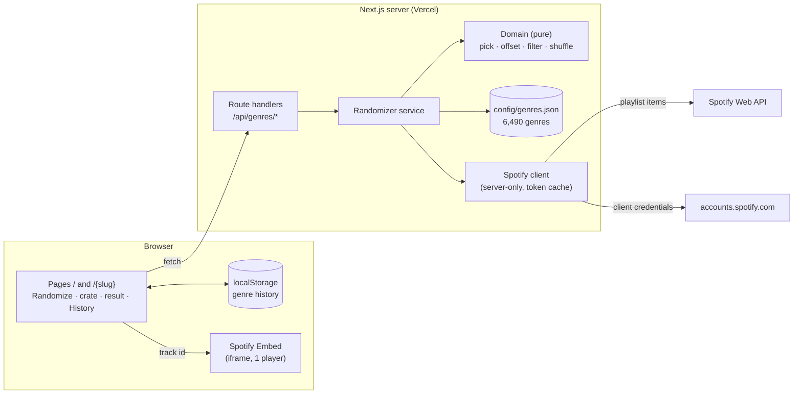
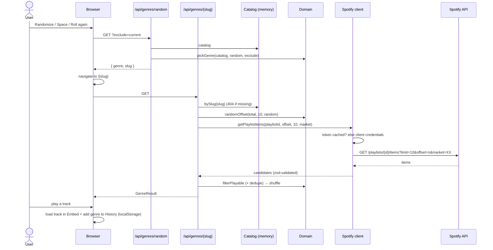

# Architecture — iteration 1

Related: PRD (`docs/prd.md`), ADR-0001…0007. Human walkthrough of each request: `docs/guides/request-flow.md`.

## Components



- **Browser** never sees Spotify credentials or tokens (ADR-0002). It only calls our own API.
- **Domain** is pure TypeScript with injected randomness → unit-tested without mocks.
- **Spotify client** is the only code that talks to Spotify; responses validated with zod.
- **Catalog** is a static JSON generated offline (ADR-0003), read only on the server.

## Routes (ADR-0006)

| URL | Page | Notes |
|---|---|---|
| `/` | Home: Hero + crate + History column + steps band | Row via `PageRow` (`components/layout`) |
| `/{slug}` | Genre page: turntable, tracks, player, "Your finds" trail, loading/error/empty | `slug` from `domain/slug.ts` (`R&B` → `r-and-b`); unknown → 404 |

Entry points: Randomize/Space/Roll again → random `/{slug}`; sleeve Play → that genre; History row → that genre. **Only crate actions change the crate.** Crate + History state live in layout providers, so they persist across navigation.

## API (ADR-0007)

| Endpoint | Purpose | Spotify calls |
|---|---|---|
| `GET /api/genres/random?exclude={slug}` | Pick a random catalog genre ≠ `exclude` (Randomize · Space · Roll again). Returns `{ genre, slug }`; the client navigates to `/{slug}`. | 0 |
| `GET /api/genres/{slug}` | Genre + up to 10 tracks, for every way of opening a genre (after Randomize, sleeve Play, History, shared URL/reload, retry). `slug` must exist in the catalog, otherwise `404` (no open proxy to Spotify). | 1 |

Both are dynamic and send `Cache-Control: no-store` (results are random). `{slug}` returns:

```ts
type GenreResult = {
  genre: string;          // "Acid Jazz"
  slug: string;           // "acid-jazz"
  playlistId: string;
  playlistUrl: string;    // https://open.spotify.com/playlist/{id}
  total: number;          // tracks in the playlist (genre context)
  tracks: { id: string; title: string; artists: string }[]; // ≤ 10, domain Track
};
```

Errors (`server/spotify/errors.ts` › `toHttpError`): Spotify `429` → `503` + `Retry-After`; other Spotify/network/timeout/shape errors → `502`; anything else (e.g. missing credentials) → `500`; unknown slug → `404`. The UI shows busy/error states with retry.

Market: Spotify only reports `is_playable` when the request has `market`. Users are anonymous, so `/{slug}` passes the visitor's country from Vercel's `x-vercel-ip-country` header (fallback `US`); unplayable tracks are filtered out for that country.

## Randomizer flow



Sleeve Play, History row, shared URL/reload and retry skip the first request: they go straight to `/{slug}`.

## Client state
- `useGenreHistory()` hook (`features/history`): `{ genre, slug, discoveredAt }[]` in `localStorage`, most recent first, validated with zod on read (corrupt data → empty list). Actions: add (dedupe by `slug`, ADR-0007), remove one, clear all.
- Current result and selected track: React state on the page. No state library.

## Folder structure

Layer-based backbone (routes · pure domain · server-only) with the UI organised by feature — see **ADR-0005**. Next.js strategy: *"store project files outside of `app`"* (`node_modules/next/dist/docs/01-app/01-getting-started/02-project-structure.md`).

```
config/genres.json            # generated catalog (committed)
scripts/build-genres.mjs      # one-time: thesoundsofspotify → genres.json
src/
  app/                        # routing only (Next special files)
    layout.tsx  globals.css   # root layout: html, fonts, design tokens
    (site)/layout.tsx         # shared shell: header, crate + history providers, decorative vinyl (ADR-0006)
    (site)/page.tsx           # / → features/home (Hero + crate)
    (site)/[genre]/page.tsx   # /{slug} → features/result; unknown slug → not-found
    (site)/not-found.tsx
    api/genres/random/route.ts
    api/genres/[slug]/route.ts
  features/                   # UI + client state, one folder per feature
    home/                     # HomeView (Hero + crate), HowItWorks
    crate/                    # CrateFlip, CrateProvider, tones, useCrate
    randomizer/               # useRandomize (→ /{random slug}), RandomizeShortcut (Space)
    result/                   # ResultView = GenreResult · TrackList · PlayerSlot (TrackPlayer) · notices, useResult
    history/                  # HistoryPanel, HistoryColumn (home), RecentFinds (genre page), HistoryProvider, useGenreHistory
  components/                 # shared, feature-agnostic
    ui/                       # shadcn/ui primitives
    brand/                    # Vinyl, Sparkle
    layout/                   # SiteHeader
  domain/                     # pure, unit-tested (TDD) — no React, no I/O
    slug.ts  pick-genre.ts  random-offset.ts  filter-tracks.ts  shuffle.ts  (+ types: genre, track, history)
  server/                     # server-only
    catalog.ts                # loads/validates genres.json once: array (random pick) + Map slug → entry
    randomizer.ts             # service: domain + catalog + spotify
    spotify/ token.ts  playlists.ts  schemas.ts  errors.ts   # errors.ts: SpotifyError + toHttpError (429 → 503, other → 502)
  mocks/                      # design-phase placeholder data (removed when real data lands)
  lib/                        # tiny shared helpers
tests/e2e/                    # Playwright: desktop + touch phone (Pixel 7)
tests/msw/                    # MSW server + Spotify handlers for unit tests
# Unit/component tests sit next to their file: src/**/<name>.test.ts(x) (Vitest + Testing Library, jsdom).
# Async Server Components are covered by e2e only (Vitest can't render them).
# Open (Phase E): server-side fetch runs inside the Next process, so MSW in vitest.setup.ts does not reach it
# during e2e; decide how e2e mocks Spotify (e.g. a test-only base URL served by MSW) when server/spotify lands.
```

Import rules (ADR-0005): features use each other only through `features/<name>/index.ts`; `domain/` imports nothing from React/UI/server; `server/` is never imported by client code.

## Genre catalog script
- Run manually (`npm run genres:build`, i.e. `node --env-file=.env.local scripts/build-genres.mjs`); not part of the build.
- Paginates `GET /users/thesoundsofspotify/playlists` (limit 50 → ~142 requests at 1 req/s ≈ 2.5 min, honours `429` `Retry-After`; aborts without writing on 403/repeated errors).
- Keeps names starting with `The Sound of ` (minus non-genres such as *The Sound of Everything*; drops *The Needle* country lists), stores `{ genre, playlistId, total }`, sorted by genre. 2026-11-15 run: 7,085 listed → 6,490 genres.
- Output committed → app has no runtime dependency on the listing endpoint.
- Playlists with fewer than 10 tracks are kept (shorter lists are fine); only empty playlists (`total = 0`) are dropped.
