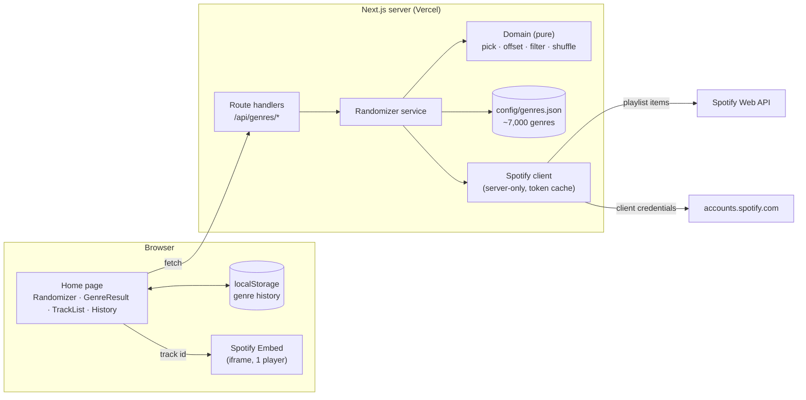
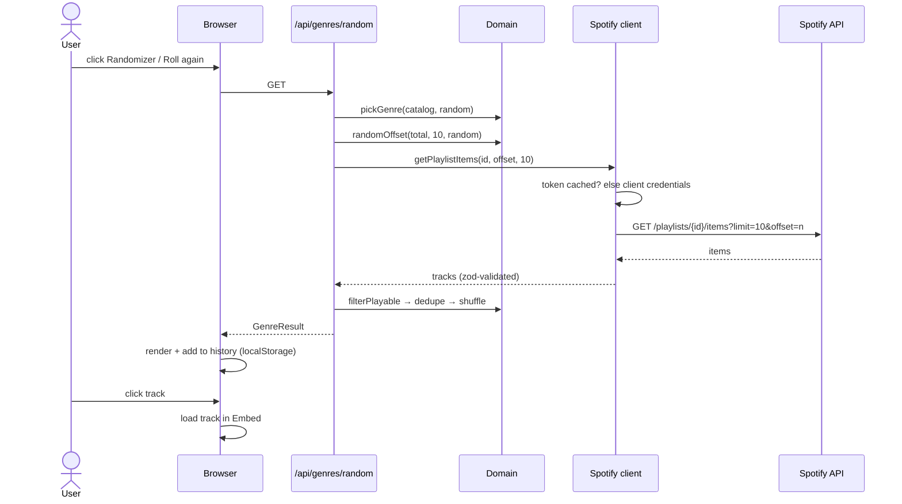

# Architecture — iteration 1

Related: PRD (`docs/prd.md`), ADR-0001…0006.

## Components



- **Browser** never sees Spotify credentials or tokens (ADR-0002). It only calls our own API.
- **Domain** is pure TypeScript with injected randomness → unit-tested without mocks.
- **Spotify client** is the only code that talks to Spotify; responses validated with zod.
- **Catalog** is a static JSON generated offline (ADR-0003), read only on the server.

## Routes (ADR-0006)

| URL | Page | Notes |
|---|---|---|
| `/` | Home: Hero + crate + History column + steps band | Row via `PageRow` (`components/layout`) |
| `/{slug}` | Genre page: turntable, tracks, player, "Your finds" trail, loading/error/empty | `slug` from `domain/slug.ts` (`R&B` → `r-and-b`); unknown → 404 |

Entry points: Randomize/Space/Roll again → random `/{slug}`; sleeve Play → that genre; History row → that genre. **Only crate actions change the crate.** Crate + History state live in layout providers, so they persist across navigation.

## API

| Endpoint | Purpose |
|---|---|
| `GET /api/genres/random` | Random genre + up to 10 tracks (Randomizer, "roll again"). |
| `GET /api/genres/{playlistId}` | New sample of up to 10 tracks for a known genre (history click). `playlistId` must exist in the catalog, otherwise `404` (prevents using the app as an open proxy to Spotify). |

Both return the same shape and are not cached (`no-store`, results are random):

```ts
type GenreResult = {
  genre: string;          // "acid jazz"
  playlistId: string;
  playlistUrl: string;    // https://open.spotify.com/playlist/{id}
  total: number;          // tracks in the playlist (genre context)
  tracks: { id: string; name: string; artists: string[] }[]; // ≤ 10
};
```

Errors: Spotify `429` → `503` + `Retry-After`; other Spotify/network errors → `502`. The UI shows an error state with retry.

## Randomizer flow



History click: same flow via `GET /api/genres/{playlistId}`, skipping `pickGenre`; the history entry is not duplicated.

## Client state
- `useGenreHistory()` hook (`features/history`): `{ genre, playlistId, discoveredAt }[]` in `localStorage`, most recent first, validated with zod on read (corrupt data → empty list). Actions: add (dedupe by `playlistId`), remove one, clear all.
- Current result and selected track: React state on the page. No state library.

## Folder structure

Layer-based backbone (routes · pure domain · server-only) with the UI organised by feature — see **ADR-0005**. Next.js strategy: *"store project files outside of `app`"* (`node_modules/next/dist/docs/01-app/01-getting-started/02-project-structure.md`).

```
config/genres.json            # generated catalog (committed)
scripts/build-genres.mjs      # one-time: thesoundsofspotify → genres.json
src/
  app/                        # routing only (Next special files)
    layout.tsx  globals.css   # root layout: html, fonts, design tokens
    (site)/layout.tsx         # shared shell: header, crate + history providers, decorative vinyl (ADR-0006)
    (site)/page.tsx           # / → features/home (Hero + crate)
    (site)/[genre]/page.tsx   # /{slug} → features/result; unknown slug → not-found
    (site)/not-found.tsx
    api/genres/random/route.ts
    api/genres/[playlistId]/route.ts
  features/                   # UI + client state, one folder per feature
    home/                     # HomeView (Hero + crate), HowItWorks
    crate/                    # CrateFlip, CrateProvider, tones, useCrate
    randomizer/               # useRandomize (→ /{random slug}), RandomizeShortcut (Space)
    result/                   # ResultView = GenreResult · TrackList · PlayerSlot (TrackPlayer) · notices, useResult
    history/                  # HistoryPanel, HistoryColumn (home), RecentFinds (genre page), HistoryProvider, useGenreHistory
  components/                 # shared, feature-agnostic
    ui/                       # shadcn/ui primitives
    brand/                    # Vinyl, Sparkle
    layout/                   # SiteHeader
  domain/                     # pure, unit-tested (TDD) — no React, no I/O
    slug.ts  pick-genre.ts  random-offset.ts  filter-tracks.ts  shuffle.ts  (+ types: genre, track, history)
  server/                     # server-only
    catalog.ts                # loads/validates genres.json
    randomizer.ts             # service: domain + catalog + spotify
    spotify/ token.ts  playlists.ts  schemas.ts
  mocks/                      # design-phase placeholder data (removed when real data lands)
  lib/                        # tiny shared helpers
tests/e2e/                    # Playwright (Spotify mocked with MSW)
```

Import rules (ADR-0005): features use each other only through `features/<name>/index.ts`; `domain/` imports nothing from React/UI/server; `server/` is never imported by client code.

## Genre catalog script
- Run manually (`node scripts/build-genres.mjs`) with `.env.local` credentials; not part of the build.
- Paginates `GET /users/thesoundsofspotify/playlists` (~700 requests, throttled, honours `429`).
- Keeps names starting with `The Sound of `, stores `{ genre, playlistId, total }`, sorted by genre.
- Output committed → app has no runtime dependency on the listing endpoint.
- Playlists with fewer than 10 tracks are kept (shorter lists are fine); only empty playlists (`total = 0`) are dropped.
